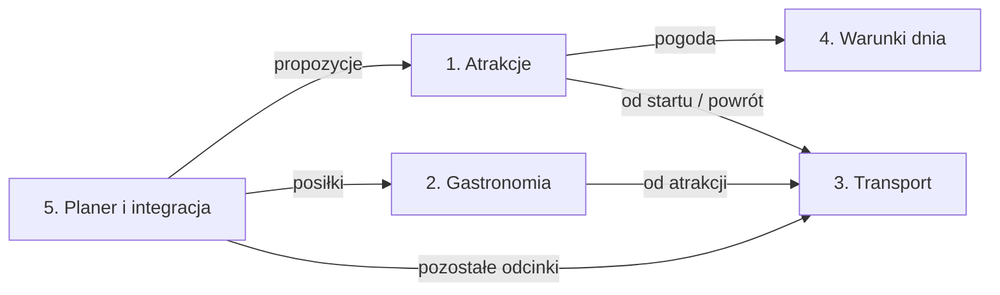
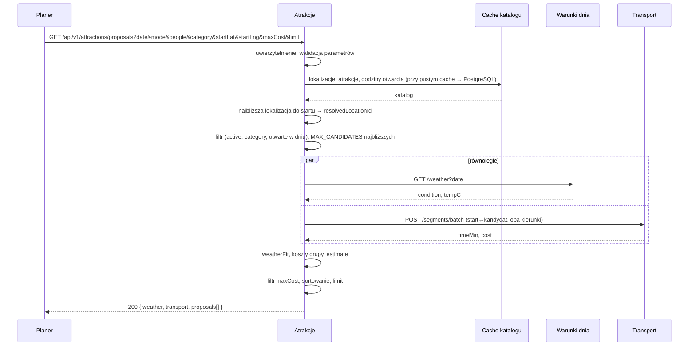
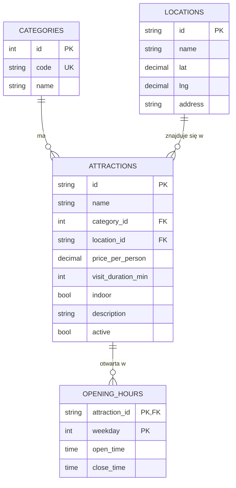
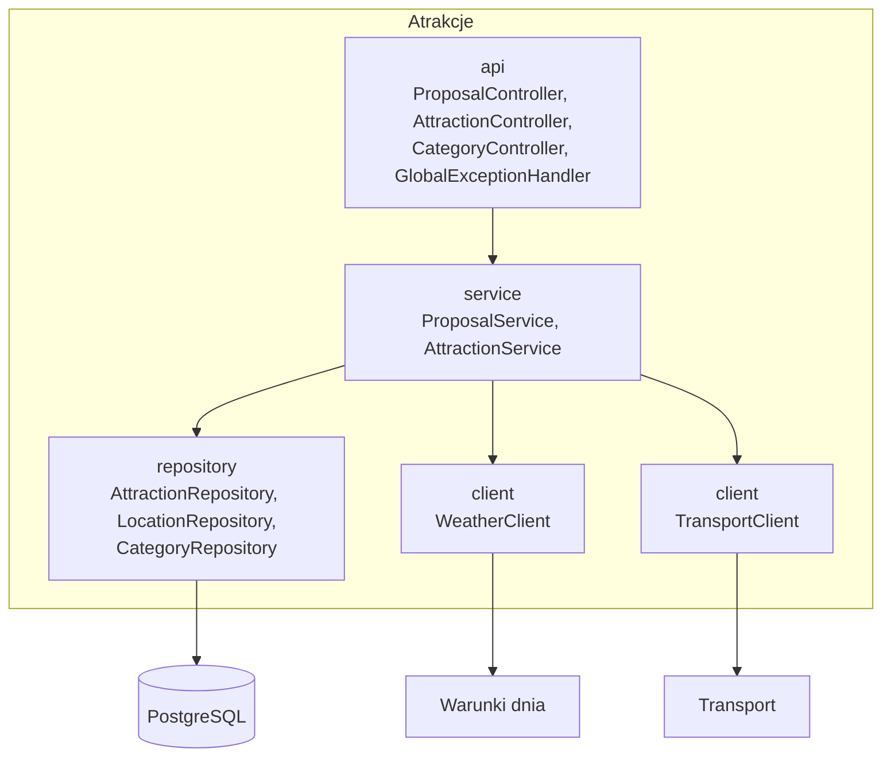

# Mikroserwis „Atrakcje” – dokumentacja architektoniczna

| | |
|---|---|
| **Serwis** | 1. Atrakcje |
| **Wersja dokumentu** | 0.2 (szkic) |
| **Data** | 2026-11-19 |
| **Klient serwisu** | 5. Planer i integracja |
| **Zależności** | 4. Warunki dnia, 3. Transport |
| **Stos** | Java 25, Spring Boot 4.1, JPA, Spring Security, PostgreSQL, Flyway |

---

## 1. Cel i zakres

Serwis **Atrakcje** udostępnia katalog atrakcji (kategorie, lokalizacje, ceny, czasy zwiedzania, godziny otwarcia, informacja „pod dachem”) i na żądanie Planera zwraca **propozycje atrakcji na dany dzień**. Każda propozycja zawiera:

- dopasowanie do pogody (na podstawie serwisu Warunki dnia),
- czas i koszt dotarcia z punktu startowego oraz szacowany powrót (na podstawie serwisu Transport),
- godziny otwarcia w danym dniu,
- łączny szacunek czasu i kosztu dla podanej liczby osób.

### 1.1. Poza zakresem

| Odpowiedzialność | Kto ją realizuje |
|---|---|
| Wybór atrakcji do planu, kolejność wizyt | Planer |
| Kontrola budżetu całego dnia i okna 10:00–16:00 | Planer (Atrakcje zwracają godziny otwarcia, żeby mógł to sprawdzić) |
| Posiłki i lokale | Gastronomia |
| Wyliczanie odcinków między lokalizacjami | Transport |
| Prognozy pogody | Warunki dnia |
| Uwierzytelnianie użytkowników końcowych | Planer / gateway |

---

## 2. Kontekst w systemie



Strzałka prowadzi od klienta do dostawcy. Atrakcje są **klientem** Warunków dnia i Transportu oraz **dostawcą** dla Planera.

### 2.1. Rola w procesie składania planu

1. **Planer → Atrakcje:** prośba o propozycje na dzień → wybór pierwszej atrakcji. ← *ten serwis*
2. Planer → Gastronomia: posiłki z dojazdem od pierwszej atrakcji (Planer przekazuje `location.id` zwrócone przez Atrakcje).
3. Planer → Transport: pozostałe odcinki (lokal → druga atrakcja → start).
4. Planer: kontrola budżetu i godzin.

---

## 3. API

Bazowy prefiks: **`/api/v1`** (obowiązkowy dla wszystkich endpointów biznesowych). Format: JSON, UTF-8. Waluta: PLN, kwoty zaokrąglane do 2 miejsc po przecinku (HALF_UP).

### 3.1. `GET /api/v1/attractions/proposals` – propozycje na dzień

#### Parametry wejściowe

| Parametr | Typ | Wymagany | Domyślnie | Opis |
|---|---|---|---|---|
| `date` | `YYYY-MM-DD` | tak | – | Data planu, nie wcześniejsza niż dzisiejsza; przekazywana do Warunków dnia |
| `maxCost` | liczba ≥ 0 | nie | brak limitu | Maks. łączny koszt dla grupy (bilety + dojazd + powrót) |
| `mode` | `walk` \| `transit` \| `car` | tak | – | Sposób podróży; przekazywany do Transportu |
| `people` | int 1–20 | nie | `1` | Liczba osób |
| `category` | string (lista kodów po przecinku) | nie | wszystkie | Filtr kategorii, np. `museum,park` |
| `startLat` | float [-90, 90] | tak | – | Szerokość geograficzna punktu startowego |
| `startLng` | float [-180, 180] | tak | – | Długość geograficzna punktu startowego |
| `limit` | int 1–50 | nie | `10` | Maksymalna liczba propozycji |

Przykład:

```
GET /api/v1/attractions/proposals?date=2026-06-14&maxCost=200&mode=transit&people=3&category=museum&startLat=52.2297&startLng=21.0122&limit=5
```

#### Odpowiedź `200 OK`

```json
{
  "date": "2026-06-14",
  "start": {
    "lat": 52.2297,
    "lng": 21.0122,
    "resolvedLocationId": "LOC_HOTEL_CENTRUM"
  },
  "mode": "transit",
  "people": 3,
  "weather":   { "condition": "rain", "tempC": 14, "source": "ok" },
  "transport": { "source": "ok" },
  "proposals": [
    {
      "id": "ATR_001",
      "name": "Muzeum Narodowe",
      "category": "museum",
      "location": { "id": "LOC_MUZ_NAR", "lat": 52.2316, "lng": 21.0247 },
      "indoor": true,
      "weatherFit": "good",
      "visitDurationMin": 90,
      "openingHours": { "open": "10:00", "close": "18:00" },
      "ticket":    { "perPerson": 25.00, "total": 75.00 },
      "fromStart": { "timeMin": 18, "costPerPerson": 4.40, "costTotal": 13.20 },
      "toStart":   { "timeMin": 20, "costPerPerson": 4.40, "costTotal": 13.20 },
      "estimate":  { "totalTimeMin": 128, "totalCost": 101.40, "complete": true }
    }
  ]
}
```

Przy niedostępnych zależnościach (patrz 6):

```json
"weather":   { "condition": null, "tempC": null, "source": "unavailable" },
"transport": { "source": "unavailable" }
```

#### Opis pól wyjściowych

| Pole | Opis |
|---|---|
| `start.resolvedLocationId` | Lokalizacja z katalogu przypisana do współrzędnych startu (patrz 5.2) |
| `weather` | Warunki dnia użyte do doboru; `source`: `ok` \| `unavailable` |
| `transport.source` | `ok` \| `unavailable` – czy Transport odpowiedział (brak pojedynczego odcinka nie zmienia tej flagi) |
| `location.id` | Identyfikator wspólny z Transportem; Planer przekazuje go do Gastronomii i Transportu |
| `weatherFit` | `good` \| `ok` \| `poor` \| `null` (gdy brak pogody) |
| `openingHours` | Godziny otwarcia w dniu `date`; `null`, gdy atrakcja nie ma zdefiniowanych godzin (traktowana jako otwarta cały dzień, patrz 5.4) |
| `ticket.perPerson` / `ticket.total` | Cena biletu dla jednej osoby / × `people` |
| `fromStart` | Dojazd **ze startu do atrakcji** w trybie `mode`: `timeMin` – czas w minutach, `costPerPerson` – koszt jednej osoby, `costTotal` – koszt grupy |
| `toStart` | Szacowany **powrót z atrakcji do startu**; pytamy Transport o odcinek w odwrotnym kierunku (czas może się różnić) |
| `estimate.totalTimeMin` | `fromStart.timeMin + visitDurationMin + toStart.timeMin` (brakujące składniki pomijane) |
| `estimate.totalCost` | `ticket.total + fromStart.costTotal + toStart.costTotal` (brakujące składniki pomijane) |
| `estimate.complete` | `false`, gdy `fromStart` lub `toStart` jest `null` – szacunek obejmuje wtedy tylko znane składniki |

`fromStart` / `toStart` mają wartość `null`, gdy Transport nie zna danego odcinka lub jest niedostępny.

**Zasady liczenia kosztu dojazdu dla grupy:**

| `mode` | `costPerPerson` | `costTotal` |
|---|---|---|
| `walk` | `0` | `0` |
| `transit` | `cost` z Transportu | `costPerPerson × people` |
| `car` | `costTotal / people` | `cost` z Transportu – koszt jednego pojazdu (bez mnożenia przez `people`; patrz otwarta kwestia 8) |

`estimate` to szacunek dla wariantu „tylko ta jedna atrakcja”. Finalny budżet i czas dnia liczy Planer.

### 3.2. Endpointy pomocnicze

| Endpoint | Opis | Zależności |
|---|---|---|
| `GET /api/v1/attractions` | Katalog z filtrami `category`, `indoor`; paginacja `page` (od 0), `size` (1–100, domyślnie 20) | brak |
| `GET /api/v1/attractions/{id}` | Szczegóły atrakcji wraz z godzinami otwarcia | brak |
| `GET /api/v1/categories` | Słownik kategorii do formularza Planera | brak |
| `GET /actuator/health` | Stan serwisu (patrz 6.1) | baza; W i T tylko informacyjnie |

Odpowiedź katalogu (paginacja):

```json
{ "items": [ ... ], "page": 0, "size": 20, "totalItems": 134, "totalPages": 7 }
```

### 3.3. Błędy

Format błędu:

```json
{ "error": { "code": "VALIDATION_ERROR", "message": "Parametr 'mode' musi być jednym z: walk, transit, car", "field": "mode" } }
```

| Kod HTTP | `code` | Kiedy |
|---|---|---|
| 400 | `VALIDATION_ERROR` | Brak wymaganego parametru, zły format lub data w przeszłości, współrzędne lub `people`/`limit`/`size` poza zakresem, nieznany `mode` lub kategoria |
| 401 | `UNAUTHORIZED` | Brak lub nieprawidłowy token (patrz 9) |
| 403 | `FORBIDDEN` | Token bez wymaganego uprawnienia |
| 404 | `NOT_FOUND` | `GET /attractions/{id}` dla nieistniejącego ID |
| 422 | `START_NOT_RESOLVED` | Współrzędne startu zbyt daleko od jakiejkolwiek znanej lokalizacji (tylko w wariancie 5.2) |
| 200 | – | Brak wyników po filtrach → `proposals: []` |
| 500 | `INTERNAL_ERROR` | Błąd serwisu (bez szczegółów technicznych w odpowiedzi) |

Niedostępność zależności **nie** powoduje błędu – serwis degraduje odpowiedź (patrz 6).

---

## 4. Kontrakty z zależnościami

> Warunki dnia i Transport nie zależą od nikogo, więc jako pierwsze udostępniają przykładowe odpowiedzi. Atrakcje rozwijamy na mockach tych odpowiedzi (profil `mock`, testy z WireMock).

### 4.1. Warunki dnia

```
GET /weather?date=2026-06-14
```

```json
{ "date": "2026-06-14", "condition": "rain", "tempC": 14, "precipitationMm": 6 }
```

Oczekiwane wartości `condition`: `sun`, `cloudy`, `rain`, `snow` (do uzgodnienia jako wspólny słownik). Nieznana wartość `condition` jest traktowana jak brak danych (`weatherFit = null`) i logowana jako ostrzeżenie.

### 4.2. Transport

Preferowany wariant – zapytanie zbiorcze (jedno wywołanie zamiast 2 × N):

```
POST /segments/batch
```

```json
{
  "mode": "transit",
  "pairs": [
    { "from": "LOC_HOTEL_CENTRUM", "to": "LOC_MUZ_NAR" },
    { "from": "LOC_MUZ_NAR", "to": "LOC_HOTEL_CENTRUM" }
  ]
}
```

```json
[
  { "from": "LOC_HOTEL_CENTRUM", "to": "LOC_MUZ_NAR", "timeMin": 18, "cost": 4.4 },
  { "from": "LOC_MUZ_NAR", "to": "LOC_HOTEL_CENTRUM", "timeMin": 20, "cost": 4.4 }
]
```

Para nieobecna w odpowiedzi = odcinek nieznany. Wariant zapasowy: `GET /segments?from=&to=&mode=` wywoływany równolegle dla każdej pary.

Do uzgodnienia: czy `cost` jest za osobę (`transit`) czy za pojazd (`car`).

---

## 5. Logika przetwarzania

### 5.1. Przepływ `GET /api/v1/attractions/proposals`



Wywołania W i T są wykonywane poza transakcją bazodanową.

### 5.2. Rozwiązanie punktu startowego

Transport operuje na tabeli odcinków między **znanymi lokalizacjami**, a Planer przesyła **współrzędne**. Serwis przypisuje współrzędne do najbliższej lokalizacji z tabeli `locations` (odległość haversine, liczona w aplikacji na zbuforowanej liście lokalizacji). Jeśli najbliższa lokalizacja jest dalej niż `APP_START_MAX_DISTANCE_M` (np. 1000 m) → `422 START_NOT_RESOLVED`.

> Alternatywa: Transport przyjmuje współrzędne bezpośrednio. Wtedy krok 5.2 znika, a `resolvedLocationId` nie jest zwracane. **Decyzja do podjęcia z zespołem Transportu.**

### 5.3. Dopasowanie do pogody (`weatherFit`)

| `condition` | `indoor = true` | `indoor = false` |
|---|---|---|
| `sun` | `ok` | `good` |
| `cloudy` | `good` | `good` |
| `rain` | `good` | `poor` |
| `snow` | `good` | `poor` |
| brak danych / nieznana wartość | `null` | `null` |

### 5.4. Filtrowanie i sortowanie

1. **Filtr katalogowy:** `active = true`, `category` (jeśli podano), otwarte w dniu tygodnia `date`:
   - atrakcja **bez żadnych** wierszy w `opening_hours` → traktowana jako otwarta cały dzień (`openingHours = null`),
   - atrakcja z wierszami, ale **bez wiersza** dla dnia tygodnia `date` → zamknięta, odrzucana.
   Dzień tygodnia według ISO-8601: 1 = poniedziałek … 7 = niedziela.
2. **Wstępna selekcja:** spośród pozostałych zostaje `APP_MAX_CANDIDATES` (domyślnie 50, nie mniej niż maks. `limit`) najbliższych startowi w linii prostej (haversine). Ogranicza to zapytanie do Transportu do 2 × `APP_MAX_CANDIDATES` par niezależnie od wielkości katalogu.
3. **Wyliczenie** `ticket`, `fromStart`, `toStart`, `estimate` (reguły z 3.1).
4. **Filtr `maxCost`** (jeśli podano): odrzucamy, gdy `estimate.totalCost > maxCost`. Dla `estimate.complete = false` porównujemy tylko znane składniki – pozycja nie jest odrzucana z powodu nieznanego kosztu dojazdu.
5. **Sortowanie** (kolejne klucze):
   1. `estimate.complete` – najpierw `true`,
   2. `weatherFit`: `good` → `ok` → `poor` → `null`,
   3. `fromStart.timeMin` rosnąco (`null` na końcu),
   4. `id` rosnąco (deterministyczne rozstrzyganie remisów).
6. **Obcięcie** do `limit`.

---

## 6. Odporność na awarie

| Sytuacja | Zachowanie |
|---|---|
| Warunki dnia nie odpowiadają / błąd | `weather.source = "unavailable"`, `condition = tempC = null`, `weatherFit = null` (drugi klucz sortowania z 5.4 nie różnicuje pozycji) |
| Transport nie odpowiada | `transport.source = "unavailable"`, `fromStart = toStart = null`, `estimate.complete = false` (liczone tylko z biletów i czasu zwiedzania) |
| Brak konkretnego odcinka w Transporcie | `null` tylko dla tej atrakcji, `transport.source` pozostaje `ok` |
| Timeout zależności | `APP_DEPENDENCY_TIMEOUT_MS` (np. 2000 ms), bez ponowień |
| Seria błędów zależności | Circuit breaker (Resilience4j) per zależność: po przekroczeniu progu błędów wywołania są pomijane na czas `APP_CIRCUIT_OPEN_MS` i od razu stosowana jest degradacja |

Planer zawsze dostaje `200`, o ile parametry są poprawne – decyzję o pominięciu niepełnych propozycji podejmuje sam.

### 6.1. Health-check

| Endpoint | Co sprawdza |
|---|---|
| `/actuator/health/liveness` | Tylko stan procesu |
| `/actuator/health/readiness` | Proces + połączenie z bazą |
| `/actuator/health` | Jak readiness; dodatkowo w `details` stan W i T (`reachable: true/false`) |

Stan W i T **nie wpływa** na status serwisu: Atrakcje działają bez nich w trybie zdegradowanym, a uzależnienie od nich powodowałoby wyłączanie lub restartowanie instancji przy awarii innego serwisu.

---

## 7. Model danych

Serwis przechowuje wyłącznie katalog (PostgreSQL). Pogoda i odcinki są pobierane na żądanie i nie są zapisywane w bazie (mogą być krótko buforowane w pamięci, patrz 10).



| Tabela | Rola | Uwagi |
|---|---|---|
| `categories` | Słownik kategorii | Źródło dla `GET /categories` |
| `locations` | Punkty na mapie (atrakcje i punkty startowe) | `id` **zgodne z tabelą odcinków Transportu** |
| `attractions` | Katalog atrakcji | `price_per_person × people` = `ticket.total` |
| `opening_hours` | Godziny otwarcia *(opcjonalna)* | Jeden przedział na dzień; semantyka braku wierszy w 5.4 |

### 7.1. DDL (PostgreSQL, migracja Flyway `V1__init.sql`)

```sql
CREATE TABLE categories (
  id    SERIAL PRIMARY KEY,
  code  VARCHAR(32) UNIQUE NOT NULL,
  name  VARCHAR(64) NOT NULL
);

CREATE TABLE locations (
  id       VARCHAR(32) PRIMARY KEY,
  name     VARCHAR(128) NOT NULL,
  lat      DECIMAL(9,6) NOT NULL CHECK (lat BETWEEN -90 AND 90),
  lng      DECIMAL(9,6) NOT NULL CHECK (lng BETWEEN -180 AND 180),
  address  VARCHAR(255)
);

CREATE TABLE attractions (
  id                  VARCHAR(32) PRIMARY KEY,
  name                VARCHAR(128) NOT NULL,
  category_id         INT NOT NULL REFERENCES categories(id),
  location_id         VARCHAR(32) NOT NULL REFERENCES locations(id),
  price_per_person    DECIMAL(8,2) NOT NULL CHECK (price_per_person >= 0),
  visit_duration_min  INT NOT NULL CHECK (visit_duration_min > 0),
  indoor              BOOLEAN NOT NULL,
  description         TEXT,
  active              BOOLEAN NOT NULL DEFAULT TRUE
);

CREATE TABLE opening_hours (
  attraction_id  VARCHAR(32) NOT NULL REFERENCES attractions(id) ON DELETE CASCADE,
  weekday        SMALLINT NOT NULL CHECK (weekday BETWEEN 1 AND 7),  -- ISO-8601: 1 = poniedziałek
  open_time      TIME NOT NULL,
  close_time     TIME NOT NULL,
  PRIMARY KEY (attraction_id, weekday),
  CHECK (close_time > open_time)
);

-- PostgreSQL nie indeksuje kluczy obcych automatycznie
CREATE INDEX idx_attr_category ON attractions(category_id);
CREATE INDEX idx_attr_location ON attractions(location_id);
```

Dane przykładowe ładowane są migracją `V2__seed.sql`. Te same dane wykorzystują testy integracyjne (Testcontainers).

---

## 8. Struktura wewnętrzna serwisu

Architektura warstwowa (kontroler → serwis → repozytorium / klient), pakiet bazowy `pl.psso.attractions`.



| Moduł | Odpowiedzialność |
|---|---|
| `api` | Mapowanie HTTP, walidacja (`@Valid`), mapowanie na DTO (`record`), kody błędów z 3.3 (`@RestControllerAdvice`) |
| `service` | Logika biznesowa z sekcji 5, transakcje (`@Transactional(readOnly = true)` dla zapytań), cache katalogu |
| `repository` | Spring Data JPA – dostęp do katalogu |
| `client` | `RestClient` z timeoutem i circuit breakerem; w profilu `mock` zastępowane implementacjami zwracającymi przykłady z sekcji 4 |
| `config` | Spring Security, klienci HTTP, `@ConfigurationProperties` (prefiks `app.`) |

### 8.1. Konfiguracja (zmienne środowiskowe)

| Zmienna | Przykład | Opis |
|---|---|---|
| `SERVER_PORT` | `8001` | Port serwisu |
| `SPRING_DATASOURCE_URL` | `jdbc:postgresql://db:5432/attractions` | Połączenie z bazą |
| `SPRING_DATASOURCE_USERNAME` / `SPRING_DATASOURCE_PASSWORD` | `attractions` / *(sekret)* | Dane dostępowe do bazy |
| `SPRING_PROFILES_ACTIVE` | `mock` | `mock` – lokalne mocki W i T; `local` – wyłączone uwierzytelnianie |
| `APP_WEATHER_URL` | `http://weather:8004` | Adres Warunków dnia |
| `APP_TRANSPORT_URL` | `http://transport:8003` | Adres Transportu |
| `APP_DEPENDENCY_TIMEOUT_MS` | `2000` | Timeout wywołań zależności |
| `APP_CIRCUIT_OPEN_MS` | `30000` | Czas otwarcia circuit breakera |
| `APP_START_MAX_DISTANCE_M` | `1000` | Maks. odległość przy przypisaniu startu |
| `APP_MAX_CANDIDATES` | `50` | Maks. liczba kandydatów wysyłanych do Transportu |
| `APP_CATALOG_CACHE_TTL_S` | `300` | Czas życia cache katalogu |
| `APP_WEATHER_CACHE_TTL_S` | `600` | Czas życia cache pogody (per data) |
| `SPRING_SECURITY_OAUTH2_RESOURCESERVER_JWT_ISSUER_URI` | `http://auth:9000` | Wystawca tokenów JWT (patrz 9) |

---

## 9. Bezpieczeństwo

- Serwis jest bezstanowy: brak sesji, CSRF wyłączony, brak logowania formularzem i Basic.
- Endpointy `/api/v1/**` wymagają tokenu JWT (Spring Security OAuth2 Resource Server) z uprawnieniem `SCOPE_attractions.read`. Tokeny dla wywołań między serwisami wystawia wspólny serwer autoryzacji (otwarta kwestia 9).
- `/actuator/health/**` jest publiczny; pozostałe endpointy Actuatora nie są wystawiane na zewnątrz.
- Profil `local` (wyłącznie lokalnie i w demonstracji) zezwala na wszystkie żądania bez tokenu.
- Atrakcje wywołują W i T z własnym tokenem (client credentials), jeśli te serwisy go wymagają.
- Odpowiedzi błędów nie zawierają stack trace'ów ani szczegółów wyjątków; sekrety wyłącznie w zmiennych środowiskowych.

---

## 10. Skalowalność i obserwowalność

| Obszar | Rozwiązanie |
|---|---|
| Skalowanie poziome | Serwis bezstanowy – dowolna liczba instancji za load balancerem; stan wyłącznie w PostgreSQL |
| Katalog | Rzadko zmieniany, czytany przy każdym zapytaniu → cache w pamięci instancji (Caffeine, TTL `APP_CATALOG_CACHE_TTL_S`); zmiany katalogu widoczne najpóźniej po TTL |
| Pogoda | Cache per `date` (TTL `APP_WEATHER_CACHE_TTL_S`) – wiele zapytań o ten sam dzień = jedno wywołanie W |
| Transport | Jedno zbiorcze wywołanie, liczba par ograniczona przez `APP_MAX_CANDIDATES` (5.4) |
| Współbieżność | Wątki wirtualne (`spring.threads.virtual.enabled=true`); wywołania W i T równolegle |
| Baza | Pula połączeń HikariCP; brak transakcji w trakcie wywołań zewnętrznych |
| Katalog `GET /attractions` | Paginacja (3.2) |
| Obserwowalność | Nagłówek `X-Correlation-Id` (przyjmowany lub generowany) przekazywany do W i T oraz w logach; metryki Micrometer (czas odpowiedzi, czas i błędy zależności, stan circuit breakera) |

---

## 11. Testy

| Poziom | Narzędzia | Zakres |
|---|---|---|
| Jednostkowe (`*Test`) | JUnit 5, Mockito | `weatherFit`, koszty grupy dla każdego `mode`, `estimate` i `complete`, filtr `maxCost`, kolejność sortowania, godziny otwarcia, haversine i przypisanie startu |
| Integracyjne (`*IT`) | `@SpringBootTest`, Testcontainers (PostgreSQL), WireMock | Endpointy z danymi z `V2__seed.sql` i zaślepionymi W/T; scenariusze degradacji (brak pogody, brak transportu, brak odcinka, timeout); kody błędów z 3.3; zabezpieczenia (401/403) |
| Kontraktowe | WireMock (stuby z przykładów z sekcji 4) | Zgodność z przykładowymi odpowiedziami udostępnionymi przez Warunki dnia i Transport; przykładowa odpowiedź Atrakcji udostępniona Planerowi |

---

## 12. Otwarte kwestie

| # | Kwestia | Z kim |
|---|---|---|
| 1 | Wspólna lista `locationId` (atrakcje + punkty startowe) w tabeli odcinków | Transport |
| 2 | Współrzędne startu: mapowanie po naszej stronie czy po stronie Transportu | Transport |
| 3 | Czy `cost` w Transporcie jest za osobę czy za pojazd (`car`) | Transport |
| 4 | Dostępność `POST /segments/batch` | Transport |
| 5 | Wspólny słownik `mode` i `condition` | Wszyscy |
| 6 | Czy `opening_hours` wchodzi do zakresu | Zespół |
| 7 | Czy `maxCost` ma obejmować powrót, czy tylko dojazd + bilety | Planer |
| 8 | `car` dla grup większych niż jeden pojazd (np. > 5 osób) – wiele pojazdów? | Planer, Transport |
| 9 | Wspólny serwer autoryzacji i uprawnienia (`scope`) dla wywołań między serwisami | Wszyscy |
| 10 | Horyzont prognozy pogody – jak daleko w przód może być `date` | Warunki dnia |
