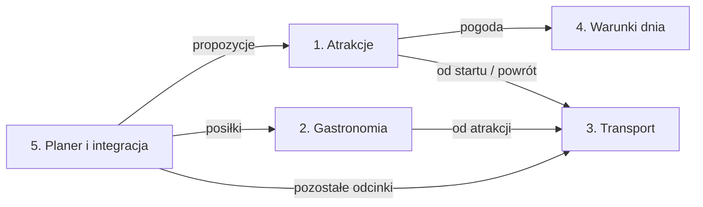
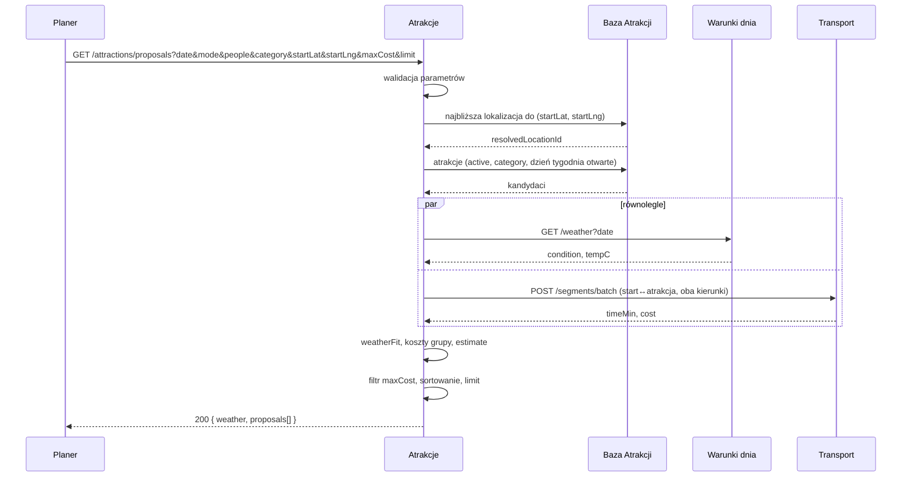
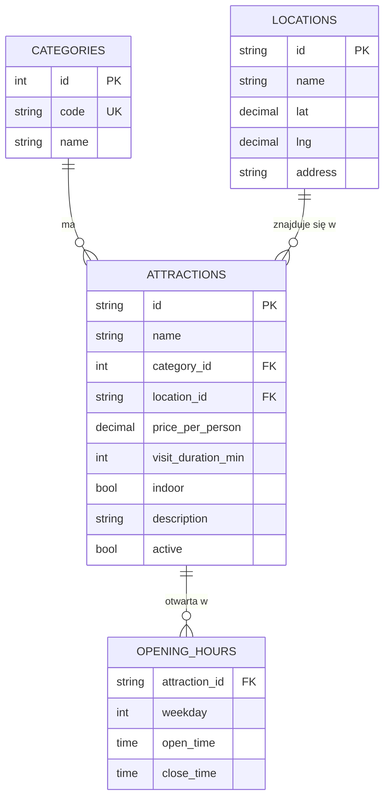
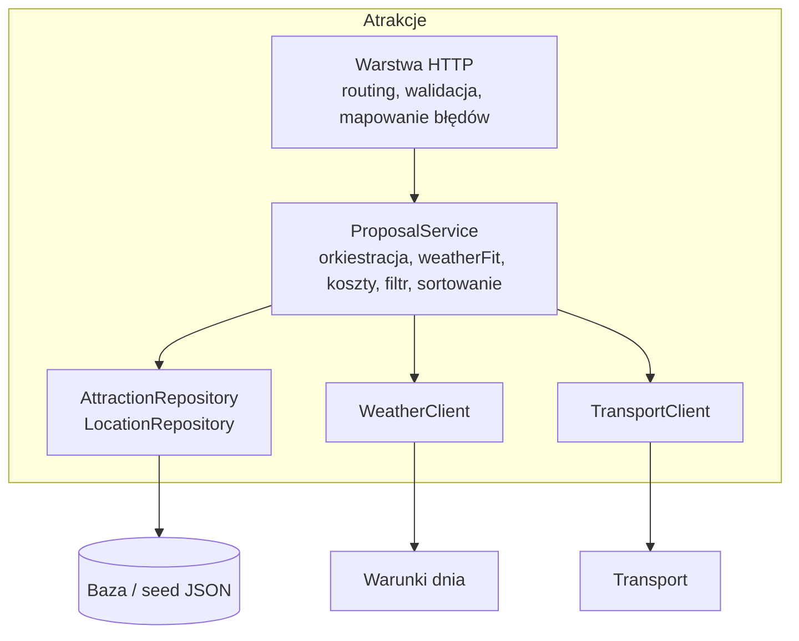

# Mikroserwis „Atrakcje” – dokumentacja architektoniczna

| | |
|---|---|
| **Serwis** | 1. Atrakcje |
| **Wersja dokumentu** | 0.1 (szkic) |
| **Data** | 2026-11-19 |
| **Klient serwisu** | 5. Planer i integracja |
| **Zależności** | 4. Warunki dnia, 3. Transport |

---

## 1. Cel i zakres

Serwis **Atrakcje** udostępnia katalog atrakcji (kategorie, lokalizacje, ceny, czasy zwiedzania, informacja „pod dachem”) i na żądanie Planera zwraca **propozycje atrakcji na dany dzień**. Każda propozycja zawiera:

- dopasowanie do pogody (na podstawie serwisu Warunki dnia),
- czas i koszt dotarcia z punktu startowego oraz szacowany powrót (na podstawie serwisu Transport),
- łączny szacunek czasu i kosztu dla podanej liczby osób.

### 1.1. Poza zakresem

| Odpowiedzialność | Kto ją realizuje |
|---|---|
| Wybór atrakcji do planu, kolejność wizyt | Planer |
| Kontrola budżetu całego dnia i okna 10:00–16:00 | Planer |
| Posiłki i lokale | Gastronomia |
| Wyliczanie odcinków między lokalizacjami | Transport |
| Prognozy pogody | Warunki dnia |

---

## 2. Kontekst w systemie



Strzałka prowadzi od klienta do dostawcy. Atrakcje są **klientem** Warunków dnia i Transportu oraz **dostawcą** dla Planera.

### 2.1. Rola w procesie składania planu

1. **Planer → Atrakcje:** prośba o propozycje na dzień → wybór pierwszej atrakcji. ← *ten serwis*
2. Planer → Gastronomia: posiłki z dojazdem od pierwszej atrakcji (Planer przekazuje `location.id` zwrócone przez Atrakcje).
3. Planer → Transport: pozostałe odcinki (lokal → druga atrakcja → start).
4. Planer: kontrola budżetu i godzin.

---

## 3. API

Bazowy prefiks: `/api/v1` (opcjonalny). Format: JSON, UTF-8. Waluta: PLN.

### 3.1. `GET /attractions/proposals` – propozycje na dzień

#### Parametry wejściowe

| Parametr | Typ | Wymagany | Domyślnie | Opis |
|---|---|---|---|---|
| `date` | `YYYY-MM-DD` | tak | – | Data planu; przekazywana do Warunków dnia |
| `maxCost` | liczba ≥ 0 | nie | brak limitu | Maks. łączny koszt dla grupy (bilety + dojazd + powrót) |
| `mode` | `walk` \| `transit` \| `car` | tak | – | Sposób podróży; przekazywany do Transportu |
| `people` | int ≥ 1 | nie | `1` | Liczba osób |
| `category` | string (lista po przecinku) | nie | wszystkie | Filtr kategorii, np. `museum,park` |
| `startLat` | float [-90, 90] | tak | – | Szerokość geograficzna punktu startowego |
| `startLng` | float [-180, 180] | tak | – | Długość geograficzna punktu startowego |
| `limit` | int 1–50 | nie | `10` | Maksymalna liczba propozycji |

Przykład:

```
GET /attractions/proposals?date=2026-06-14&maxCost=200&mode=transit&people=3&category=museum&startLat=52.2297&startLng=21.0122&limit=5
```

#### Odpowiedź `200 OK`

```json
{
  "date": "2026-06-14",
  "start": {
    "lat": 52.2297,
    "lng": 21.0122,
    "resolvedLocationId": "LOC_HOTEL_CENTRUM"
  },
  "mode": "transit",
  "people": 3,
  "weather": { "condition": "rain", "tempC": 14, "source": "ok" },
  "proposals": [
    {
      "id": "ATR_001",
      "name": "Muzeum Narodowe",
      "category": "museum",
      "location": { "id": "LOC_MUZ_NAR", "lat": 52.2316, "lng": 21.0247 },
      "indoor": true,
      "weatherFit": "good",
      "visitDurationMin": 90,
      "ticket":    { "perPerson": 25.0, "total": 75.0 },
      "fromStart": { "timeMin": 18, "costPerPerson": 4.4, "costTotal": 13.2 },
      "toStart":   { "timeMin": 20, "costPerPerson": 4.4, "costTotal": 13.2 },
      "estimate":  { "totalTimeMin": 128, "totalCost": 101.4 }
    }
  ]
}
```

#### Opis pól wyjściowych

| Pole | Opis |
|---|---|
| `start.resolvedLocationId` | Lokalizacja z katalogu przypisana do współrzędnych startu (patrz 5.2) |
| `weather` | Warunki dnia użyte do doboru; `source`: `ok` \| `unavailable` |
| `location.id` | Identyfikator wspólny z Transportem; Planer przekazuje go do Gastronomii i Transportu |
| `weatherFit` | `good` \| `ok` \| `poor` \| `null` (gdy brak pogody) |
| `ticket.perPerson` / `ticket.total` | Cena biletu dla jednej osoby / × `people` |
| `fromStart` | Dojazd **ze startu do atrakcji** w trybie `mode`: `timeMin` – czas w minutach, `costPerPerson` – koszt jednej osoby, `costTotal` – koszt grupy |
| `toStart` | Szacowany **powrót z atrakcji do startu**; pytamy Transport o odcinek w odwrotnym kierunku (czas może się różnić) |
| `estimate.totalTimeMin` | `fromStart.timeMin + visitDurationMin + toStart.timeMin` |
| `estimate.totalCost` | `ticket.total + fromStart.costTotal + toStart.costTotal` |

`fromStart` / `toStart` mają wartość `null`, gdy Transport nie zna danego odcinka.

**Zasady liczenia kosztu dojazdu dla grupy:**

| `mode` | `costTotal` |
|---|---|
| `walk` | `0` |
| `transit` | `costPerPerson × people` |
| `car` | koszt pojazdu (bez mnożenia przez `people`) |

`estimate` to szacunek dla wariantu „tylko ta jedna atrakcja”. Finalny budżet i czas dnia liczy Planer.

### 3.2. Endpointy pomocnicze

| Endpoint | Opis | Zależności |
|---|---|---|
| `GET /attractions` | Katalog z filtrami `category`, `indoor` | brak |
| `GET /attractions/{id}` | Szczegóły atrakcji | brak |
| `GET /categories` | Słownik kategorii do formularza Planera | brak |
| `GET /health` | Stan serwisu i dostępność zależności | ping do W i T |

### 3.3. Błędy

Format błędu:

```json
{ "error": { "code": "VALIDATION_ERROR", "message": "Parametr 'mode' musi być jednym z: walk, transit, car", "field": "mode" } }
```

| Kod HTTP | `code` | Kiedy |
|---|---|---|
| 400 | `VALIDATION_ERROR` | Brak wymaganego parametru, zły format daty/współrzędnych, nieznany `mode` lub kategoria |
| 404 | `NOT_FOUND` | `GET /attractions/{id}` dla nieistniejącego ID |
| 422 | `START_NOT_RESOLVED` | Współrzędne startu zbyt daleko od jakiejkolwiek znanej lokalizacji |
| 200 | – | Brak wyników po filtrach → `proposals: []` |
| 500 | `INTERNAL_ERROR` | Błąd serwisu |

Niedostępność zależności **nie** powoduje błędu – serwis degraduje odpowiedź (patrz 6).

---

## 4. Kontrakty z zależnościami

> Warunki dnia i Transport nie zależą od nikogo, więc jako pierwsze udostępniają przykładowe odpowiedzi. Atrakcje rozwijamy na mockach tych odpowiedzi.

### 4.1. Warunki dnia

```
GET /weather?date=2026-06-14
```

```json
{ "date": "2026-06-14", "condition": "rain", "tempC": 14, "precipitationMm": 6 }
```

Oczekiwane wartości `condition`: `sun`, `cloudy`, `rain`, `snow` (do uzgodnienia jako wspólny słownik).

### 4.2. Transport

Preferowany wariant – zapytanie zbiorcze (jedno wywołanie zamiast 2 × N):

```
POST /segments/batch
```

```json
{
  "mode": "transit",
  "pairs": [
    { "from": "LOC_HOTEL_CENTRUM", "to": "LOC_MUZ_NAR" },
    { "from": "LOC_MUZ_NAR", "to": "LOC_HOTEL_CENTRUM" }
  ]
}
```

```json
[
  { "from": "LOC_HOTEL_CENTRUM", "to": "LOC_MUZ_NAR", "timeMin": 18, "cost": 4.4 },
  { "from": "LOC_MUZ_NAR", "to": "LOC_HOTEL_CENTRUM", "timeMin": 20, "cost": 4.4 }
]
```

Wariant zapasowy: `GET /segments?from=&to=&mode=` wywoływany równolegle dla każdej pary.

Do uzgodnienia: czy `cost` jest za osobę (`transit`) czy za pojazd (`car`).

---

## 5. Logika przetwarzania

### 5.1. Przepływ `GET /attractions/proposals`



### 5.2. Rozwiązanie punktu startowego

Transport operuje na tabeli odcinków między **znanymi lokalizacjami**, a Planer przesyła **współrzędne**. Serwis przypisuje współrzędne do najbliższej lokalizacji z tabeli `locations` (odległość haversine). Jeśli najbliższa lokalizacja jest dalej niż `START_MAX_DISTANCE_M` (np. 1000 m) → `422 START_NOT_RESOLVED`.

> Alternatywa: Transport przyjmuje współrzędne bezpośrednio. Wtedy krok 5.2 znika, a `resolvedLocationId` nie jest zwracane. **Decyzja do podjęcia z zespołem Transportu.**

### 5.3. Dopasowanie do pogody (`weatherFit`)

| `condition` | `indoor = true` | `indoor = false` |
|---|---|---|
| `sun` | `ok` | `good` |
| `cloudy` | `good` | `good` |
| `rain` | `good` | `poor` |
| `snow` | `good` | `poor` |
| brak danych | `null` | `null` |

### 5.4. Filtrowanie i sortowanie

1. Filtr: `active = true`, `category` (jeśli podano), otwarte w dniu tygodnia `date` (jeśli istnieje `opening_hours`).
2. Wyliczenie `ticket`, `fromStart`, `toStart`, `estimate`.
3. Filtr: `estimate.totalCost ≤ maxCost` (jeśli podano). Pozycje z `fromStart = null` lub `toStart = null` – liczone z kosztem dojazdu jako nieznanym; nie odrzucamy, ale sortujemy na koniec.
4. Sortowanie: `weatherFit` (`good` → `ok` → `poor` → `null`), następnie `fromStart.timeMin` rosnąco.
5. Obcięcie do `limit`.

---

## 6. Odporność na awarie

| Sytuacja | Zachowanie |
|---|---|
| Warunki dnia nie odpowiadają / błąd | `weather.source = "unavailable"`, `weatherFit = null`, brak sortowania po pogodzie |
| Transport nie odpowiada | `fromStart = toStart = null`, `estimate` liczone tylko z biletów, flaga w odpowiedzi `"transport": "unavailable"` |
| Brak konkretnego odcinka w Transporcie | `null` tylko dla tej atrakcji |
| Timeout zależności | `DEPENDENCY_TIMEOUT_MS` (np. 2000 ms), bez ponowień w wersji demonstracyjnej |

Planer zawsze dostaje `200`, o ile parametry są poprawne – decyzję o pominięciu niepełnych propozycji podejmuje sam.

---

## 7. Model danych

Serwis przechowuje wyłącznie katalog. Pogoda i odcinki są pobierane na żądanie i nie są zapisywane.



| Tabela | Rola | Uwagi |
|---|---|---|
| `categories` | Słownik kategorii | Źródło dla `GET /categories` |
| `locations` | Punkty na mapie (atrakcje i punkty startowe) | `id` **zgodne z tabelą odcinków Transportu** |
| `attractions` | Katalog atrakcji | `price_per_person × people` = `ticket.total` |
| `opening_hours` | Godziny otwarcia *(opcjonalna)* | Pomija atrakcje zamknięte danego dnia |

### 7.1. DDL (PostgreSQL)

```sql
CREATE TABLE categories (
  id    SERIAL PRIMARY KEY,
  code  VARCHAR(32) UNIQUE NOT NULL,
  name  VARCHAR(64) NOT NULL
);

CREATE TABLE locations (
  id       VARCHAR(32) PRIMARY KEY,
  name     VARCHAR(128) NOT NULL,
  lat      DECIMAL(9,6) NOT NULL,
  lng      DECIMAL(9,6) NOT NULL,
  address  VARCHAR(255)
);

CREATE TABLE attractions (
  id                  VARCHAR(32) PRIMARY KEY,
  name                VARCHAR(128) NOT NULL,
  category_id         INT NOT NULL REFERENCES categories(id),
  location_id         VARCHAR(32) NOT NULL REFERENCES locations(id),
  price_per_person    DECIMAL(8,2) NOT NULL CHECK (price_per_person >= 0),
  visit_duration_min  INT NOT NULL CHECK (visit_duration_min > 0),
  indoor              BOOLEAN NOT NULL,
  description         TEXT,
  active              BOOLEAN NOT NULL DEFAULT TRUE
);

CREATE TABLE opening_hours (
  attraction_id  VARCHAR(32) REFERENCES attractions(id) ON DELETE CASCADE,
  weekday        SMALLINT CHECK (weekday BETWEEN 1 AND 7),
  open_time      TIME NOT NULL,
  close_time     TIME NOT NULL,
  PRIMARY KEY (attraction_id, weekday)
);

CREATE INDEX idx_attr_category ON attractions(category_id);
CREATE INDEX idx_attr_indoor   ON attractions(indoor);
```

Dla wersji demonstracyjnej wystarczy SQLite lub plik `seed/attractions.json` o tej samej strukturze.

---

## 8. Struktura wewnętrzna serwisu



| Moduł | Odpowiedzialność |
|---|---|
| Warstwa HTTP | Parsowanie i walidacja parametrów, serializacja, kody błędów |
| `ProposalService` | Logika biznesowa z sekcji 5 |
| Repozytoria | Dostęp do katalogu, wyszukanie najbliższej lokalizacji |
| `WeatherClient`, `TransportClient` | Wywołania HTTP z timeoutem; podmienialne na mocki (tryb `MOCK_DEPENDENCIES=true`) |

### 8.1. Konfiguracja (zmienne środowiskowe)

| Zmienna | Przykład | Opis |
|---|---|---|
| `PORT` | `8001` | Port serwisu |
| `DATABASE_URL` | `sqlite:///data/attractions.db` | Połączenie z bazą |
| `WEATHER_URL` | `http://weather:8004` | Adres Warunków dnia |
| `TRANSPORT_URL` | `http://transport:8003` | Adres Transportu |
| `DEPENDENCY_TIMEOUT_MS` | `2000` | Timeout wywołań zależności |
| `START_MAX_DISTANCE_M` | `1000` | Maks. odległość przy przypisaniu startu |
| `MOCK_DEPENDENCIES` | `false` | Użycie lokalnych mocków W i T |

---

## 9. Testy

| Poziom | Zakres |
|---|---|
| Jednostkowe | `weatherFit`, koszty grupy dla każdego `mode`, `estimate`, filtr `maxCost`, sortowanie, haversine |
| Integracyjne | Endpointy z bazą seed i zamockowanymi W/T; scenariusze degradacji (brak pogody, brak transportu, brak odcinka) |
| Kontraktowe | Zgodność z przykładowymi odpowiedziami udostępnionymi przez Warunki dnia i Transport; przykładowa odpowiedź Atrakcji udostępniona Planerowi |

---

## 10. Otwarte kwestie

| # | Kwestia | Z kim |
|---|---|---|
| 1 | Wspólna lista `locationId` (atrakcje + punkty startowe) w tabeli odcinków | Transport |
| 2 | Współrzędne startu: mapowanie po naszej stronie czy po stronie Transportu | Transport |
| 3 | Czy `cost` w Transporcie jest za osobę czy za pojazd (`car`) | Transport |
| 4 | Dostępność `POST /segments/batch` | Transport |
| 5 | Wspólny słownik `mode` i `condition` | Wszyscy |
| 6 | Czy `opening_hours` wchodzi do zakresu | Zespół |
| 7 | Czy `maxCost` ma obejmować powrót, czy tylko dojazd + bilety | Planer |